<div align="center">

# SDD Harness Kit

**Que la IA construya lo que habéis acordado, no lo que se le ocurra por el camino.**

[](https://github.com/DisTinta/sdd-harness-kit/releases)
[](LICENSE)


**Idioma:** Español · [English](docs/en/README.en.md)

[Arranque guiado](docs/es/GUIA-PASO-A-PASO.md) · [Uso diario](docs/es/USO.md) · [Manual](docs/es/MANUAL.md) · [Briefing para Producto](docs/es/presentacion.md) · [Changelog](docs/es/CHANGELOG.md)

</div>

---

## Qué es

El **SDD Harness Kit** es un arnés de **Spec-Driven Development** que instalas en tu repositorio:
skills, subagentes, hooks deterministas, estándares por stack y plantillas, con una sola doctrina
para **Claude Code**, **Cursor** y **GitHub Copilot**.

**El problema.** Un ticket de tres frases llega a una IA. El ticket es ambiguo, y la IA rellena los
huecos **inventando**: alcance extra, casos que nadie pidió, otra arquitectura. Un humano revisa al
final, con cientos de líneas ya escritas, y lo que se entrega puede «funcionar» sin ser lo que
Producto quería. Una historia S se convierte en una L sin que nadie lo haya decidido.

**La solución.** Primero se cierra el contrato —qué sí, qué no y cómo se verifica— con
[OpenSpec](https://github.com/Fission-AI/OpenSpec), y después se construye contra ese contrato, con
test primero. Mientras el copiloto trabaja, el kit **hace cumplir** las reglas en lugar de solo
escribirlas: bloquea secretos, impide reescribir tests o specs para que encajen con un atajo,
rechaza listas de tareas incompletas y no deja cerrar el turno con la suite en rojo.

> No es un producto que vea el usuario final ni sustituye el criterio del equipo. Es la forma de
> trabajar del equipo de desarrollo cuando usa copilotos.

## Cómo funciona

Cada fase reduce ambigüedad. En **cinco puntos decide una persona** (◆); el resto puede ir más
rápido con IA.

```mermaid
flowchart LR
  T([Ticket]) --> P["1 · Planificar<br/>◆ recortar alcance"]
  P --> S["2 · Especificar<br/>◆ firmar el contrato"]
  S --> C["3 · Plan de código<br/>◆ aprobar el plan"]
  C --> I["4 · Implementar<br/>tarea a tarea, TDD"]
  I --> V["5 · Verificar<br/>◆ leer la evidencia"]
  V --> D["6 · Documentar"]
  D --> E["7 · Entregar<br/>◆ el porqué y el merge"]
  E --> X["8 · Cerrar<br/>retro"]
  classDef human fill:#fff3cd,stroke:#b8860b,color:#000;
  class P,S,C,V,E human;
```



El detalle de cada fase, con los comandos y artefactos, está en el [Manual](docs/es/MANUAL.md).

## Por qué un *harness*

Es la diferencia entre una convención escrita y una convención que se cumple. Estos automatismos
saltan solos mientras el copiloto trabaja:

| Si el copiloto intenta… | El kit… |
|---|---|
| Pegar contraseñas o tokens, o leer ficheros `.env` | Lo bloquea. Los secretos no entran en el contexto |
| Borrados masivos, `push --force`, tocar producción | Lo bloquea o pide confirmación humana |
| Escribir código antes de que se audite la spec | Lo impide hasta que exista el informe del `spec-auditor` |
| Reescribir tests o la spec para que encajen con un atajo | Pregunta. Una persona decide si el diseño cambió de verdad |
| Commitear un cambio de esquema o de contrato sin tocar la documentación | Lo impide |
| Escribir un `tasks.md` sin rama, sin verificación o sin restaurar datos | Lo rechaza en el momento |
| Cerrar el turno con tests en rojo | No le deja cerrar |

Al abrir cada sesión, además, inyecta la rama, los changes de OpenSpec activos, las tareas
pendientes y los comandos del proyecto. Detalle en [Los 10 hooks](#los-10-hooks).

---

## Empezar en 3 pasos

**1. Instala el kit en tu proyecto** (primero en modo `--dry-run` para ver qué haría):

```bash
./install.sh --dest /ruta/a/mi-proyecto --dry-run
./install.sh --dest /ruta/a/mi-proyecto
```

<details>
<summary>Windows (PowerShell) y opciones de frontend</summary>

```bash
# Linux / macOS
./install.sh --dest /ruta/a/mi-proyecto --no-frontend          # solo API, sin Playwright
./install.sh --dest /ruta/a/mi-proyecto --frontend livewire    # o react
./install.sh --dest /ruta/a/mi-proyecto --stack laravel        # forzar el adaptador
```

```powershell
# Windows
.\install.ps1 -Dest C:\proyectos\mi-proyecto -DryRun
.\install.ps1 -Dest C:\proyectos\mi-proyecto
.\install.ps1 -Dest C:\proyectos\mi-proyecto -NoFrontend
.\install.ps1 -Dest C:\proyectos\mi-proyecto -Frontend livewire
```

</details>

**2. Inicializa OpenSpec** en el proyecto (`openspec init`) y cablea su `config.yaml` con la
plantilla del kit. **No ejecutes `/init`**: sobrescribiría los ficheros de memoria que apuntan a la
doctrina.

**3. Comprueba la instalación:**

```bash
bash ./doctor.sh --dest /ruta/a/mi-proyecto      # Windows: .\doctor.ps1 -Dest C:\proyectos\mi-proyecto
```

La [guía paso a paso](docs/es/GUIA-PASO-A-PASO.md) cubre prerrequisitos, OpenSpec y problemas
frecuentes en Windows y Unix.

Funciona igual con los comandos nativos de OpenSpec (`/opsx:explore`, `/opsx:propose`,
`/opsx:apply`, `/opsx:sync`, `/opsx:archive`), con los del kit o con ambos a la vez: los hooks y la
doctrina actúan sobre la ruta del fichero, no sobre qué comando lo escribió. Tabla de
correspondencia en el [Manual](docs/es/MANUAL.md).

---

## Qué instala

<details>
<summary>Ver la tabla completa de ficheros</summary>

| Ruta en tu repositorio | Qué es |
|---|---|
| `ai-specs/skills/` | **30 skills**, fuente canónica. Incluye `/show-spec-working`, `/adversarial-review`, `/migration-review`, `/architecture-audit`, `/privacy-ethics-check`, `/openspec-archive`, `/meta-prompt`, `/kit-health` |
| `ai-specs/agents/` | **9 subagentes**, fuente canónica. Incluye `spec-auditor` y la trilogía `tdd-test-writer` / `tdd-implementer` / `tdd-refactorer`, un contexto aislado por fase del ciclo |
| `ai-specs/templates/` | Plantillas de story, ADR, PR, artefactos OpenSpec y `config.yaml.tpl` |
| `.claude/skills/` · `.cursor/skills/` | Referencias a `ai-specs` (symlink, o copia si el SO no lo permite) |
| `.claude/agents/` · `.cursor/agents/` | Ídem |
| `.claude/hooks/` | **10 hooks** deterministas del ciclo de vida (incluye bloqueo de lectura de secretos) |
| `.claude/openspec-archive.sh` | Índice y retención de `openspec/changes/archive/` (lo usa `/openspec-archive`) |
| `.claude/sdd-harness.env` | **La única pieza que cambia entre proyectos**: comandos, rutas, `BRANCH_PREFIX` y guardas |
| `.mcp.json` · `.cursor/mcp.json` | MCP del proyecto: **Context7** (docs de librerías) y **Playwright** (demo de UI; se omite con `--no-frontend`) |
| `.claude/sync-artifacts.sh` · `.ps1` | Reconstruye las referencias a `ai-specs` |
| `docs/base-standards.md` | La doctrina. El kit la sustituye al actualizarse |
| `docs/documentation-standards.md` | Reglas de documentación y el gate antes de commit |
| `docs/openspec-tasks-mandatory-steps.md` | Qué debe contener un `tasks.md` para ser válido |
| `docs/backend-standards.md` | Capas y convenciones **de tu stack** (del adaptador) |
| `docs/frontend-standards.md` | Arquitectura UI (React o Livewire según `--frontend`) |
| `tests/a11y/smoke.example.*` | Scaffold axe-core (no es un test hasta cablear `test:a11y`) |
| `docs/project-context.md` | **El único fichero que escribes tú.** Sobrevive a las actualizaciones |
| `.cursor/rules/` | Las mismas reglas para Cursor: núcleo, TDD, OpenSpec y stack |
| `.github/` | Instrucciones de Copilot, workflows de review, CI backend y `frontend.yml`, plantilla de PR |
| `CLAUDE.md` `AGENTS.md` | Apuntan a `docs/base-standards.md` |

</details>

---

## Las tres ideas del diseño

### 1. Fuente canónica única

Las skills viven una sola vez, en `ai-specs/`. `.claude/` y `.cursor/` la referencian. Editas un
fichero y las dos herramientas lo ven.

Donde el sistema operativo permite symlinks, son symlinks. Donde no —Windows sin modo desarrollador—
son copias, y `sync-artifacts` las refresca. Si los symlinks se materializan como stubs de texto, las
skills no cargan: el kit lo detecta y lo arregla con copias + sync.

### 2. Doctrina separada del contexto

| Fichero | Quién lo escribe | Qué pasa al actualizar el kit |
|---|---|---|
| `docs/base-standards.md` | El kit | Se sustituye (kit-owned) |
| `docs/documentation-standards.md` | El kit | Se sustituye (kit-owned) |
| `docs/openspec-tasks-mandatory-steps.md` | El kit | Se sustituye (kit-owned) |
| Hooks, skills del kit, reglas Cursor del núcleo | El kit | Se sustituyen (kit-owned) |
| `docs/backend-standards.md` / `frontend-standards.md` / `sdd-harness.env` / MCP | El adaptador o tú | Se conservan; `--force` los pisa |
| `docs/project-context.md` | **Tú** | Nunca se toca |
| `tests/a11y/smoke.example.*` | Kit la primera vez; luego **tú** | Se conserva; `--force` lo pisa |

Así una actualización del kit trae correcciones del harness sin borrar el cableado del proyecto.
Un hook te avisa si intentas editar doctrina por proyecto.

### 3. Núcleo agnóstico, adaptador por stack

Todo lo dependiente del stack está en `.claude/sdd-harness.env`. Los hooks lo cargan de forma segura
(allowlist, sin `eval`); las skills lo leen como contexto dinámico. **Ninguno de los dos tiene un
comando escrito dentro.**

Para soportar un stack nuevo no tocas ni una skill ni un hook: copias `_template.env`, rellenas las
variables del contrato, escribes `<stack>.backend-standards.md`, y ya está. La lista de sitios
que hay que tocar para que quede completo está en [CONTRIBUTING.md](docs/es/CONTRIBUTING.md).

| Adaptador | Detección automática | Trae |
|---|---|---|
| `adonisjs` | `package.json` con `@adonisjs/core` | env, backend-standards, reglas de Cursor, `ci.yml` |
| `laravel` | `artisan` + `composer.json` | ídem; FE React o Livewire (`--frontend`) |
| `fastify` | `"fastify"` en `package.json` de la raíz o de un paquete del workspace | ídem, más `.dependency-cruiser.js`: monorepo hexagonal, Postgres+pgvector en CI y migraciones reversibles |
| `_template` | cualquier otro caso | env y standards en blanco, comentados para rellenar |
| UI `react` / `livewire` | `--frontend` o detección automática | `frontend-standards.md` + `.github/workflows/frontend.yml` + `tests/a11y/smoke.example.*` |

---

## Los 10 hooks

| Evento | Script | Qué garantiza |
|---|---|---|
| `SessionStart` | `session-context.sh` | Inyecta rama, changes activos, tasks, comandos y apuntadores a `project-context` |
| `UserPromptSubmit` | `block-secrets.sh` | Ninguna credencial entra en el prompt |
| `PreToolUse` Read | `block-secret-reads.sh` | No se lee `.env` / credentials / claves privadas al contexto |
| `PreToolUse` Bash | `block-dangerous-bash.sh` | Borrados masivos, `push --force`, producción, confirmación al instalar dependencias |
| `PreToolUse` Bash | `docs-gate.sh` | No se commitea un cambio de esquema o de contrato con la documentación sin tocar |
| `PreToolUse` Edit | `spec-audit-gate.sh` | No se escribe código ni tests de un change hasta que el `spec-auditor` lo ha revisado (`KIT_SPEC_AUDIT_GATE`) |
| `PreToolUse` Edit | `protect-specs-and-tests.sh` | Crear specs sí; reescribirlas pregunta; tests y migraciones aplicadas piden confirmación |
| `PostToolUse` | `post-edit-quality.sh` | Formato, análisis estático, guardas de capas y aviso de English-only (sin `eval`) |
| `PostToolUse` | `validate-tasks.sh` | `tasks.md` sin Step 0, sin `BRANCH_PREFIX` o sin pasos obligatorios no pasa |
| `Stop` | `verify-tests.sh` | No se cierra el turno con la suite en rojo (escape hatch documentado para spikes) |

---

## Requisitos

| Requisito | Para qué | Si falta |
|---|---|---|
| `node` ≥ 20.19 | OpenSpec, el lanzador de hooks (`invoke.cjs`) y `npx` de los MCP | OpenSpec no instala; en Windows los hooks pueden caer en WSL; Context7/Playwright no arrancan |
| `bash` | Ejecutar los scripts `.sh`. En Windows lo trae Git for Windows | Los hooks no se ejecutan |
| `jq` | Parsear el JSON que reciben los hooks | Se desactivan solos, sin romper la sesión |
| `git` | Contexto de sesión y protección de migraciones | Degradación parcial |

En Windows: `winget install jqlang.jq`.

---

## Documentación

### Por dónde leer (orden recomendado)

1. **[GUIA-PASO-A-PASO.md](docs/es/GUIA-PASO-A-PASO.md)** — arrancar: prerrequisitos, instalar, OpenSpec, doctor, troubleshooting (Windows/Unix).
2. **[USO.md](docs/es/USO.md)** — qué ejecutar el día 1, qué en cada ticket y problemas frecuentes.
3. **Cuando ya estés trabajando:** [MANUAL.md](docs/es/MANUAL.md) (flujo F0–F8, matriz de artefactos, reglas) + [PROMPTS.md](docs/es/PROMPTS.md) (prompts P0–P15 listos para copiar).
4. **Solo si quieres el procedimiento fino de una herramienta:** el `SKILL.md` de esa skill en [`core/ai-specs/skills/`](core/ai-specs/skills/) (o, tras instalar, `ai-specs/skills/<nombre>/SKILL.md` en tu proyecto). Igual con los agents en [`core/ai-specs/agents/`](core/ai-specs/agents/).

### Índice de documentos

| Documento | Español | English |
|---|---|---|
| Arranque | [GUIA-PASO-A-PASO.md](docs/es/GUIA-PASO-A-PASO.md) | [STEP-BY-STEP.md](docs/en/STEP-BY-STEP.md) |
| Uso cotidiano | [USO.md](docs/es/USO.md) | [USAGE.md](docs/en/USAGE.md) |
| Manual (F0–F8) | [MANUAL.md](docs/es/MANUAL.md) | [MANUAL.en.md](docs/en/MANUAL.en.md) |
| Prompts P0–P15 | [PROMPTS.md](docs/es/PROMPTS.md) | [PROMPTS.en.md](docs/en/PROMPTS.en.md) |
| Config / adaptadores | [CONFIG.md](docs/es/CONFIG.md) | [CONFIG.en.md](docs/en/CONFIG.en.md) |
| Ejemplo extremo a extremo | [EJEMPLO.md](docs/es/EJEMPLO.md) | [EXAMPLE.md](docs/en/EXAMPLE.md) |
| Briefing para Producto | [presentacion.md](docs/es/presentacion.md) | [presentation.md](docs/en/presentation.md) |
| Changelog | [CHANGELOG.md](docs/es/CHANGELOG.md) | [CHANGELOG.en.md](docs/en/CHANGELOG.en.md) |
| Contribuir | [CONTRIBUTING.md](docs/es/CONTRIBUTING.md) | [CONTRIBUTING.en.md](docs/en/CONTRIBUTING.en.md) |
| Créditos | [CREDITS.md](docs/es/CREDITS.md) | [CREDITS.en.md](docs/en/CREDITS.en.md) |

Versión actual en [`VERSION`](VERSION). Normas de este repositorio (para quien mantiene el kit, no
para el proyecto instalado): [`AGENTS.md`](AGENTS.md) / [`CLAUDE.md`](CLAUDE.md).

---

## Idioma

Las skills, los agents, los standards y las plantillas están **en inglés**, porque
`base-standards.md` §2 exige inglés en todo artefacto técnico y el agente no puede leer una regla en
inglés y una instrucción en español sin incoherencia.

La documentación humana —este `README.md` y el resto en [`docs/es/`](docs/es/) y [`docs/en/`](docs/en/)—
está **en español y en inglés**, emparejada. Elige el idioma en la barra superior de cada documento
o en la tabla de arriba. Los prompts en [PROMPTS.en.md](docs/en/PROMPTS.en.md) se pegan en inglés;
los artefactos que produzcan (código, specs, commits) siguen en inglés.

---

## Qué NO hace este kit

- **No sustituye tu criterio.** Hay cinco puntos donde se detiene y espera a una persona.
- **No garantiza calidad.** Garantiza que ciertos errores concretos no pasen desapercibidos: tests
  modificados a escondidas, specs sobreescritos, secretos en contexto, capas mezcladas, `tasks.md`
  sin verificación, suites en rojo al cerrar el turno.
- **No conoce tu dominio.** Todo lo que sabe está en `docs/project-context.md` y en `sdd-harness.env`. Lo
  que no escribas ahí, el agente se lo inventará.
- **No instala OpenSpec.** Es un paso aparte, y deliberadamente: `openspec/` lo gobierna esa
  herramienta, y el kit no escribe dentro salvo sus plantillas.
- **No instala Context7 ni Playwright como dependencias del repo.** Deja la config MCP (`npx`); el
  primer uso descarga. Playwright MCP demuestra UI, no sustituye la suite E2E.

---

## Origen

Este kit nace de los apuntes de las clases del **Máster AI4Devs de [LIDR Academy](https://lidr.co)**
y toma como punto de partida ideas y convenciones de
**[`LIDR-academy/lidr-specboot`](https://github.com/LIDR-academy/lidr-specboot)** (MIT), el
repositorio de referencia del máster: la disposición de `ai-specs/` con skills y subagentes como
fuente canónica, los estándares en `docs/`, y los ficheros de memoria por copiloto
—`CLAUDE.md`, `AGENTS.md`— apuntando a una doctrina única.

Lo que este kit añade sobre ese punto de partida:

| Añadido | Qué resuelve |
|---|---|
| **Instalable** (`install.sh` / `install.ps1`, con `--dry-run`) | No montar el harness a mano en cada proyecto nuevo |
| **10 hooks deterministas** del ciclo de vida | Una convención escrita pasa a ser una convención comprobada. Actúan sobre la ruta del fichero, no sobre qué comando lo escribió |
| **Adaptadores por stack** con detección automática | Los mismos artefactos sirven para Laravel, AdonisJS o Fastify sin tocar una skill ni un hook |
| **Soporte real en Windows** | PowerShell de primera clase, copia cuando el SO no permite symlinks |
| **`doctor`** (`doctor.sh` / `doctor.ps1`) | Diagnosticar una instalación en vez de adivinar por qué no funciona |
| **Gates de secretos en profundidad** | Bloqueo en el prompt y en la lectura de ficheros, no solo en el commit |
| **30 skills y 9 subagentes** | La trilogía TDD con contexto aislado por fase, auditoría de la spec antes de codificar, `/adversarial-review`, `/migration-review`, `/architecture-audit`, `/privacy-ethics-check`, `/openspec-archive`, `/kit-health` |

El diseño, el afinado y todo lo anterior son trabajo propio. La deuda con `lidr-specboot` es de
arquitectura y convenciones, y queda declarada aquí y en [CREDITS.md](docs/es/CREDITS.md).

## Licencia

[MIT](LICENSE).
