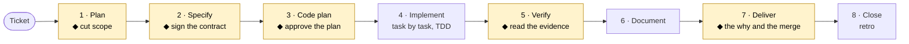

<div align="center">

# SDD Harness Kit

**Get AI to build what your team agreed on, not whatever occurs to it along the way.**

[](https://github.com/DisTinta/sdd-harness-kit/releases)
[](../../LICENSE)


**Language:** [Español](../../README.md) · English

[Guided setup](STEP-BY-STEP.md) · [Daily use](USAGE.md) · [Manual](MANUAL.en.md) · [Product briefing](presentation.md) · [Changelog](CHANGELOG.en.md)

</div>

---

## What it is

The **SDD Harness Kit** is a **Spec-Driven Development** harness you install into your repository:
skills, subagents, deterministic hooks, per-stack standards and templates, with a single doctrine
for **Claude Code**, **Cursor** and **GitHub Copilot**.

**The problem.** A three-sentence ticket reaches an AI. The ticket is ambiguous, and the AI fills
the gaps by **inventing**: extra scope, cases nobody asked for, a different architecture. A human
reviews at the end, with hundreds of lines already written, and what ships may “work” without being
what Product wanted. An S story turns into an L without anyone deciding it.

**The solution.** First close the contract —what is in, what is out, and how it is verified— with
[OpenSpec](https://github.com/Fission-AI/OpenSpec), then build against that contract, test first.
While the copilot works, the kit **enforces** the rules instead of only writing them down: it blocks
secrets, prevents rewriting tests or specs to fit a shortcut, rejects incomplete task lists and does
not let the turn end with a red suite.

> It is not a product end users see, and it does not replace the team's judgement. It is how the
> development team works when it uses copilots.

## How it works

Each phase reduces ambiguity. At **five points a person decides** (◆); the rest can go faster with
AI.



Each phase in detail, with its commands and artefacts, is in the [Manual](MANUAL.en.md).

## Why a harness

It is the difference between a written convention and an enforced one. These checks fire on their
own while the copilot works:

| If the copilot tries to… | The kit… |
|---|---|
| Paste passwords or tokens, or read `.env` files | Blocks it. Secrets do not enter the context |
| Mass deletes, `push --force`, touch production | Blocks it or asks for human confirmation |
| Write code before the spec is audited | Prevents it until the `spec-auditor` report exists |
| Rewrite tests or the spec to fit a shortcut | Asks. A person decides whether the design really changed |
| Commit a schema or contract change without touching the docs | Prevents it |
| Write a `tasks.md` with no branch, no verification or no state restore | Rejects it on the spot |
| End the turn with failing tests | Does not let it |

On every session start it also injects the branch, the active OpenSpec changes, the pending tasks
and the project commands. Details in [The 10 hooks](#the-10-hooks).

---

## Get started in 3 steps

**1. Install the kit into your project** (first with `--dry-run` to see what it would do):

```bash
./install.sh --dest /path/to/my-project --dry-run
./install.sh --dest /path/to/my-project
```

<details>
<summary>Windows (PowerShell) and frontend options</summary>

```bash
# Linux / macOS
./install.sh --dest /path/to/my-project --no-frontend          # API only, no Playwright
./install.sh --dest /path/to/my-project --frontend livewire    # or react
./install.sh --dest /path/to/my-project --stack laravel        # force the adapter
```

```powershell
# Windows
.\install.ps1 -Dest C:\projects\my-project -DryRun
.\install.ps1 -Dest C:\projects\my-project
.\install.ps1 -Dest C:\projects\my-project -NoFrontend
.\install.ps1 -Dest C:\projects\my-project -Frontend livewire
```

</details>

**2. Initialise OpenSpec** in the project (`openspec init`) and wire its `config.yaml` with the kit
template. **Do not run `/init`**: it would overwrite the memory files that point to the doctrine.

**3. Check the installation:**

```bash
bash ./doctor.sh --dest /path/to/my-project      # Windows: .\doctor.ps1 -Dest C:\projects\my-project
```

The [step-by-step guide](STEP-BY-STEP.md) covers prerequisites, OpenSpec and common problems on
Windows and Unix.

It works the same with native OpenSpec commands (`/opsx:explore`, `/opsx:propose`, `/opsx:apply`,
`/opsx:sync`, `/opsx:archive`), with the kit's, or with both at once: the hooks and the doctrine act
on the file path, not on which command wrote it. Correspondence table in the [Manual](MANUAL.en.md).

---

## What it installs

<details>
<summary>See the full file table</summary>

| Path in your repository | What it is |
|---|---|
| `ai-specs/skills/` | **30 skills**, canonical source. Includes `/show-spec-working`, `/adversarial-review`, `/migration-review`, `/architecture-audit`, `/privacy-ethics-check`, `/openspec-archive`, `/meta-prompt`, `/kit-health` |
| `ai-specs/agents/` | **9 subagents**, canonical source. Includes `spec-auditor` and the trilogy `tdd-test-writer` / `tdd-implementer` / `tdd-refactorer`, one isolated context per cycle phase |
| `ai-specs/templates/` | Story, ADR, PR, OpenSpec artefact templates and `config.yaml.tpl` |
| `.claude/skills/` · `.cursor/skills/` | References to `ai-specs` (symlink, or copy if the OS does not allow it) |
| `.claude/agents/` · `.cursor/agents/` | Same |
| `.claude/hooks/` | **10** deterministic lifecycle **hooks** (includes secret-read blocking) |
| `.claude/openspec-archive.sh` | Index and retention for `openspec/changes/archive/` (used by `/openspec-archive`) |
| `.claude/sdd-harness.env` | **The only piece that changes between projects**: commands, paths, `BRANCH_PREFIX`, and guards |
| `.mcp.json` · `.cursor/mcp.json` | Project MCP: **Context7** (library docs) and **Playwright** (UI demo; omitted with `--no-frontend`) |
| `.claude/sync-artifacts.sh` · `.ps1` | Rebuilds the references to `ai-specs` |
| `docs/base-standards.md` | The doctrine. The kit replaces it on update |
| `docs/documentation-standards.md` | Documentation rules and the pre-commit gate |
| `docs/openspec-tasks-mandatory-steps.md` | What a `tasks.md` must contain to be valid |
| `docs/backend-standards.md` | Layers and conventions **of your stack** (from the adapter) |
| `docs/frontend-standards.md` | UI architecture (React or Livewire per `--frontend`) |
| `tests/a11y/smoke.example.*` | axe-core scaffold (not a test until `test:a11y` is wired) |
| `docs/project-context.md` | **The only file you write.** Survives updates |
| `.cursor/rules/` | The same rules for Cursor: core, TDD, OpenSpec, and stack |
| `.github/` | Copilot instructions, review workflows, backend CI and `frontend.yml`, PR template |
| `CLAUDE.md` `AGENTS.md` | Point to `docs/base-standards.md` |

</details>

---

## The three design ideas

### 1. Single canonical source

Skills live once, in `ai-specs/`. `.claude/` and `.cursor/` reference it. You edit one file and
both tools see it.

Where the operating system allows symlinks, they are symlinks. Where it does not —Windows without
Developer Mode— they are copies, and `sync-artifacts` refreshes them. If symlinks materialise as text
stubs, skills do not load: the kit detects it and fixes it with copies + sync.

### 2. Doctrine separate from context

| File | Who writes it | What happens when the kit updates |
|---|---|---|
| `docs/base-standards.md` | The kit | Replaced (kit-owned) |
| `docs/documentation-standards.md` | The kit | Replaced (kit-owned) |
| `docs/openspec-tasks-mandatory-steps.md` | The kit | Replaced (kit-owned) |
| Hooks, kit skills, core Cursor rules | The kit | Replaced (kit-owned) |
| `docs/backend-standards.md` / `frontend-standards.md` / `sdd-harness.env` / MCP | The adapter or you | Kept; `--force` overwrites them |
| `docs/project-context.md` | **You** | Never touched |
| `tests/a11y/smoke.example.*` | Kit the first time; then **you** | Kept; `--force` overwrites it |

So a kit update brings harness fixes without wiping the project's wiring. A hook warns you if you
try to edit doctrine per project.

### 3. Agnostic core, per-stack adapter

Everything stack-dependent lives in `.claude/sdd-harness.env`. Hooks load it safely (allowlist, no
`eval`); skills read it as dynamic context. **Neither has a command written inside.**

To support a new stack you touch no skill and no hook: copy `_template.env`, fill in the contract
variables, write `<stack>.backend-standards.md`, and that's it. The list of places to touch for it to
be complete is in [CONTRIBUTING.en.md](CONTRIBUTING.en.md).

| Adapter | Auto-detection | Brings |
|---|---|---|
| `adonisjs` | `package.json` with `@adonisjs/core` | env, backend-standards, Cursor rules, `ci.yml` |
| `laravel` | `artisan` + `composer.json` | same; FE React or Livewire (`--frontend`) |
| `fastify` | `"fastify"` in the root `package.json` or in a workspace package | same, plus `.dependency-cruiser.js`: hexagonal monorepo, Postgres+pgvector in CI, and reversible migrations |
| `_template` | any other case | blank env and standards, commented to fill in |
| UI `react` / `livewire` | `--frontend` or auto-detection | `frontend-standards.md` + `.github/workflows/frontend.yml` + `tests/a11y/smoke.example.*` |

---

## The 10 hooks

| Event | Script | What it guarantees |
|---|---|---|
| `SessionStart` | `session-context.sh` | Injects branch, active changes, tasks, commands, and pointers to `project-context` |
| `UserPromptSubmit` | `block-secrets.sh` | No credential enters the prompt |
| `PreToolUse` Read | `block-secret-reads.sh` | `.env` / credentials / private keys are not read into context |
| `PreToolUse` Bash | `block-dangerous-bash.sh` | Mass deletes, `push --force`, production, confirmation when installing dependencies |
| `PreToolUse` Bash | `docs-gate.sh` | A schema or contract change is not committed with docs untouched |
| `PreToolUse` Edit | `spec-audit-gate.sh` | No code or tests for a change until the `spec-auditor` has reviewed it (`KIT_SPEC_AUDIT_GATE`) |
| `PreToolUse` Edit | `protect-specs-and-tests.sh` | Creating specs yes; rewriting them asks; tests and applied migrations need confirmation |
| `PostToolUse` | `post-edit-quality.sh` | Format, static analysis, layer guards, and English-only warning (no `eval`) |
| `PostToolUse` | `validate-tasks.sh` | `tasks.md` without Step 0, without `BRANCH_PREFIX`, or without mandatory steps does not pass |
| `Stop` | `verify-tests.sh` | The turn does not close with a red suite (escape hatch documented for spikes) |

---

## Requirements

| Requirement | For what | If missing |
|---|---|---|
| `node` ≥ 20.19 | OpenSpec, the hook launcher (`invoke.cjs`), and MCP `npx` | OpenSpec does not install; on Windows hooks may fall into WSL; Context7/Playwright do not start |
| `bash` | Run the `.sh` scripts. On Windows Git for Windows provides it | Hooks do not run |
| `jq` | Parse the JSON the hooks receive | They disable themselves without breaking the session |
| `git` | Session context and migration protection | Partial degradation |

On Windows: `winget install jqlang.jq`.

---

## Documentation

### Where to read (recommended order)

1. **[STEP-BY-STEP.md](STEP-BY-STEP.md)** — get started: prerequisites, install, OpenSpec, doctor, troubleshooting (Windows/Unix).
2. **[USAGE.md](USAGE.md)** — what to run on day 1, what on each ticket, and common problems.
3. **Once you are working:** [MANUAL.en.md](MANUAL.en.md) (F0–F8 flow, artefact matrix, rules) + [PROMPTS.en.md](PROMPTS.en.md) (prompts P0–P15 ready to copy).
4. **Only if you want a tool's fine-grained procedure:** that skill's `SKILL.md` in [`core/ai-specs/skills/`](../../core/ai-specs/skills/) (or, after install, `ai-specs/skills/<name>/SKILL.md` in your project). Same for agents in [`core/ai-specs/agents/`](../../core/ai-specs/agents/).

### Document index

| Document | Español | English |
|---|---|---|
| Getting started | [GUIA-PASO-A-PASO.md](../es/GUIA-PASO-A-PASO.md) | [STEP-BY-STEP.md](STEP-BY-STEP.md) |
| Daily use | [USO.md](../es/USO.md) | [USAGE.md](USAGE.md) |
| Manual (F0–F8) | [MANUAL.md](../es/MANUAL.md) | [MANUAL.en.md](MANUAL.en.md) |
| Prompts P0–P15 | [PROMPTS.md](../es/PROMPTS.md) | [PROMPTS.en.md](PROMPTS.en.md) |
| Config / adapters | [CONFIG.md](../es/CONFIG.md) | [CONFIG.en.md](CONFIG.en.md) |
| End-to-end example | [EJEMPLO.md](../es/EJEMPLO.md) | [EXAMPLE.md](EXAMPLE.md) |
| Product briefing | [presentacion.md](../es/presentacion.md) | [presentation.md](presentation.md) |
| Changelog | [CHANGELOG.md](../es/CHANGELOG.md) | [CHANGELOG.en.md](CHANGELOG.en.md) |
| Contributing | [CONTRIBUTING.md](../es/CONTRIBUTING.md) | [CONTRIBUTING.en.md](CONTRIBUTING.en.md) |
| Credits | [CREDITS.md](../es/CREDITS.md) | [CREDITS.en.md](CREDITS.en.md) |

Current version in [`VERSION`](../../VERSION). Working rules for this repository (for kit
maintainers, not the installed project): [`AGENTS.md`](../../AGENTS.md) / [`CLAUDE.md`](../../CLAUDE.md).

---

## Language

Skills, agents, standards, and templates are **in English**, because `base-standards.md` §2
requires English in every technical artefact and the agent cannot read a rule in English and an
instruction in Spanish without inconsistency.

Human documentation —the root `README.md`, this file, and the rest in [`docs/es/`](../es/) and
[`docs/en/`](./)— is **in Spanish and English**, paired. Pick the language in the top bar of each
document or in the table above. The prompts in [PROMPTS.en.md](PROMPTS.en.md) are pasted in English;
the artefacts they produce (code, specs, commits) stay in English.

---

## What this kit does NOT do

- **It does not replace your judgement.** There are five points where it stops and waits for a person.
- **It does not guarantee quality.** It guarantees that certain concrete errors do not go unnoticed:
  tests modified on the sly, overwritten specs, secrets in context, mixed layers, `tasks.md` without
  verification, red suites at turn close.
- **It does not know your domain.** Everything it knows is in `docs/project-context.md` and in
  `sdd-harness.env`. Whatever you do not write there, the agent will make up.
- **It does not install OpenSpec.** That is a separate step, deliberately: `openspec/` is governed by
  that tool, and the kit writes nothing inside except its templates.
- **It does not install Context7 or Playwright as repo dependencies.** It leaves the MCP config
  (`npx`); first use downloads. Playwright MCP demonstrates UI; it does not replace the E2E suite.

---

## Origin

This kit was born from the class notes of the **AI4Devs Master's at [LIDR Academy](https://lidr.co)**
and takes as its starting point ideas and conventions from
**[`LIDR-academy/lidr-specboot`](https://github.com/LIDR-academy/lidr-specboot)** (MIT), the
master's reference repository: the `ai-specs/` layout with skills and subagents as the canonical
source, the standards in `docs/`, and the per-copilot memory files —`CLAUDE.md`, `AGENTS.md`—
pointing to a single doctrine.

What this kit adds on top of that starting point:

| Addition | What it solves |
|---|---|
| **Installable** (`install.sh` / `install.ps1`, with `--dry-run`) | Not assembling the harness by hand in every new project |
| **10 deterministic lifecycle hooks** | A written convention becomes a checked one. They act on the file path, not on which command wrote it |
| **Per-stack adapters** with auto-detection | The same artefacts work for Laravel, AdonisJS, or Fastify without touching a skill or a hook |
| **Real Windows support** | First-class PowerShell, copy when the OS does not allow symlinks |
| **`doctor`** (`doctor.sh` / `doctor.ps1`) | Diagnose an installation instead of guessing why it does not work |
| **Deep secret gates** | Blocking at the prompt and at file read, not only at commit |
| **30 skills and 9 subagents** | The TDD trilogy with isolated context per phase, spec audit before coding, `/adversarial-review`, `/migration-review`, `/architecture-audit`, `/privacy-ethics-check`, `/openspec-archive`, `/kit-health` |

The design, the tuning, and everything above are original work. The debt to `lidr-specboot` is one
of architecture and conventions, and it is declared here and in [CREDITS.en.md](CREDITS.en.md).

## License

[MIT](../../LICENSE).
